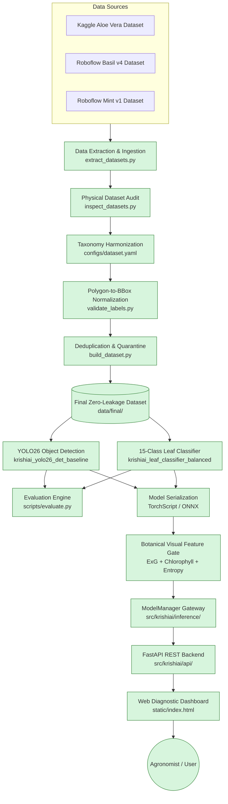

# KrishiAI — System Architecture

Comprehensive system architecture for the KrishiAI Herbal Crop Vision & Agronomic Diagnostic Platform.

## End-to-end Pipeline

## Component Responsibilities

| Component | Responsibility | Location | Status |
| :--- | :--- | :--- | :--- |
| **Dataset Manifest** | Source of truth for datasets, provenance, and hashes | `src/krishiai/data/manifest.py` | Complete & Verified |
| **Format Detection** | YOLO / COCO / VOC / Classification folder heuristics | `src/krishiai/data/formats.py` | Complete & Verified |
| **Validators** | Image, YOLO label, and polygon coordinate validation | `src/krishiai/data/validators.py` | Complete & Verified |
| **Hashing Engine** | Exact SHA256 & perceptual hash collision prevention | `src/krishiai/data/hashing.py` | Complete & Verified |
| **Settings** | Central configuration and environment overrides | `src/krishiai/config/settings.py` | Complete & Verified |
| **Training Engine** | YOLO26 Detection and Classification training | `src/krishiai/training/` | Complete & Verified |
| **Evaluation Suite** | Precision, recall, mAP, Top-1/Top-5 accuracy metrics | `src/krishiai/evaluation/` | Complete & Verified |
| **Model Serialization** | Multi-format export (TorchScript, ONNX, OpenVINO) | `src/krishiai/models/export.py` | Complete & Verified |
| **Botanical Gating** | $ExG$, chlorophyll spectrum, and entropy OOD filter | `src/krishiai/inference/model_manager.py` | Complete & Verified |
| **Unified Gateway** | Hierarchical dual-pipeline dispatch (`ModelManager`) | `src/krishiai/inference/model_manager.py` | Complete & Verified |
| **API Layer** | FastAPI HTTP server, OpenAPI v3 contracts | `src/krishiai/api/` | Complete & Verified |
| **Web Dashboard** | Responsive single-page UI with HTML5 canvas | `static/index.html` | Complete & Verified |
| **Benchmarking Engine**| Statistical latency profiling (P50/P90/P95/P99, FPS) | `src/krishiai/evaluation/benchmark.py` | Complete & Verified |
| **Robustness Suite** | 6-factor environmental perturbation stress-testing | `src/krishiai/evaluation/robustness.py` | Complete & Verified |
| **Batch Predictor** | Directory batch inference and annotated overlays | `src/krishiai/inference/batch.py` | Complete & Verified |
| **Containerization** | Production multi-stage Docker & compose config | `Dockerfile`, `docker-compose.yml` | Complete & Verified |
